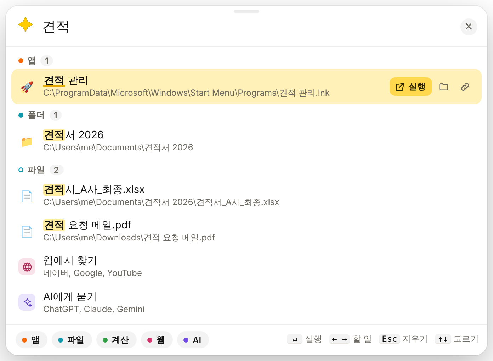

<div align="center">

# ✦ MagicKey

**어디서든 `Ctrl+Alt+Space` — 앱 실행, 파일 찾기, 계산, 웹 검색을 입력창 하나로.**

[](https://github.com/lmg6983-dotcom/MagicKey/actions/workflows/ci.yml)
[](LICENSE)




</div>

[메모킹](https://github.com/lmg6983-dotcom/MemoKing)의 매직키를 메모 없이 따로 떼어 Rust로 다시 만들었어요.

## 기능

| | 이렇게 쓰면 | 이렇게 돼요 |
|---|---|---|
| 🚀 **앱** | `카톡` · `chrm` | 시작 메뉴 프로그램 실행 |
| 📁 **파일** | `견적서` · `ㄱㅈㅅ` · `P20261170` | 파일 · 폴더 이름으로 찾아 열기 (초성, 기호 빼고도) |
| 🧮 **계산** | `1,200 × 3` · `15% * 80000` · `5 inch to cm` | 결과를 Enter 로 복사 |
| 📅 **날짜** | `3주 뒤` · `12/25까지` · `9:15부터 18:30까지` · `만 나이 1990-05-03` | 날짜 · 남은 날 · 시간 계산 |
| 🌐 **웹** | `날씨` · `naver.com` | 네이버 · Google · YouTube 검색, 주소 바로 열기 |
| ✨ **AI** | `파이썬 정렬 어떻게 해?` | ChatGPT · Claude · Gemini · Perplexity 에 묻기 |

치는 동안에는 아무것도 인터넷에 보내지 않아요. 웹 · AI 줄을 고를 때만 브라우저가 열려요.
파일은 이름만 모아요 (내용은 읽지 않음, 목록은 이 PC 안에만).

## 키

| 키 | 하는 일 |
|---|---|
| `Ctrl+Alt+Space` | 열기 · 닫기 ([바꿀 수 있어요](#설정)) |
| `↑` `↓` | 줄 고르기 |
| `←` `→` | 할 일 고르기 (열기 · 경로 복사 · 폴더 열기 · 사이트) |
| `Enter` | 실행 |
| `Ctrl+Shift+C` · `Ctrl+Shift+E` | 경로 복사 · 폴더 열기 |
| `Esc` | 지우기 → 닫기 |

아래 캡슐(앱 · 파일 · 계산 · 웹 · AI)을 누르면 그 기능을 켜고 꺼요.

## 설정

알림 영역의  아이콘 — **왼쪽 클릭**은 열기, **오른쪽 클릭**은 메뉴예요.

```
열기                    Ctrl+Alt+Space
──────────────
설정 ▸  단축키 바꾸기…   Ctrl+Alt+Space
        기능 ▸          ☑ 앱 검색 · 파일 검색 · 계산 · 웹 검색 · 웹 AI
        ──────────
        ☐ Windows 시작할 때 켜기
        파일 목록 새로 만들기
──────────────
끝내기
```

- ⌨️ **단축키 바꾸기** — 고른 뒤 새 조합을 누르면 끝. `Ctrl` · `Alt` · `Win` 중 하나와 함께 눌러요 (예: `Ctrl+Shift+Space`, `Alt+Q`). 다른 프로그램이 쓰는 키면 바꾸지 않고 알려 줘요
- 🧩 **기능** — 창 아래 캡슐과 같아요. 어느 쪽에서 바꿔도 함께 바뀌어요
- 🚀 **Windows 시작할 때 켜기** — 켜 두면 로그인할 때 알림 영역에서 대기해요
- 🔄 **파일 목록 새로 만들기** — 방금 만든 파일이 안 찾아질 때 (평소엔 10분마다 알아서)

바꾼 단축키는 이 PC 에 기억해요 (`%LOCALAPPDATA%\com.lmg6983.magickey\hotkey.txt`).

## 설치

[Releases](https://github.com/lmg6983-dotcom/MagicKey/releases/latest) 에서 `MagicKey_x.y.z_x64-setup.exe` 를 받아 실행하세요. 관리자 권한은 필요 없어요.

> [!TIP]
> 메모킹과 함께 쓰면 `Ctrl+Alt+Space` 가 겹쳐요. 메모킹은 창을 닫아도 알림 영역에 남아 키를 잡고 있어요.
> 단축키를 못 잡으면 처음 켤 때 알려 주고, 그 안내를 누르거나 ✦ 오른쪽 클릭 › 설정 › 단축키 바꾸기로 다른 키를 고르면 돼요.

## 빌드

```bash
cargo test -p magickey-core          # 계산 · 날짜 · 색인 · 웹 로직 테스트 (어느 OS 에서나)
cd app && npx @tauri-apps/cli@2 build # Windows 설치 파일 (target/release/bundle/nsis)
```

```
core/  UI 없는 로직 (calc · date · index · web · text)
app/   Tauri 2 앱 (단축키 · 알림 영역 · 명령)
ui/    입력창 (HTML · CSS · JS, 빌드 도구 없음)
```

## License

[MIT](LICENSE)
